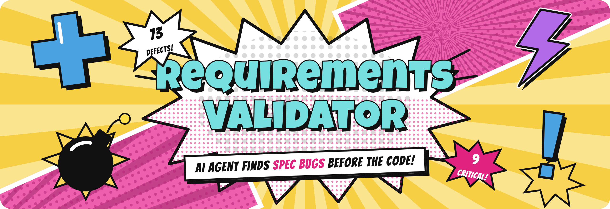
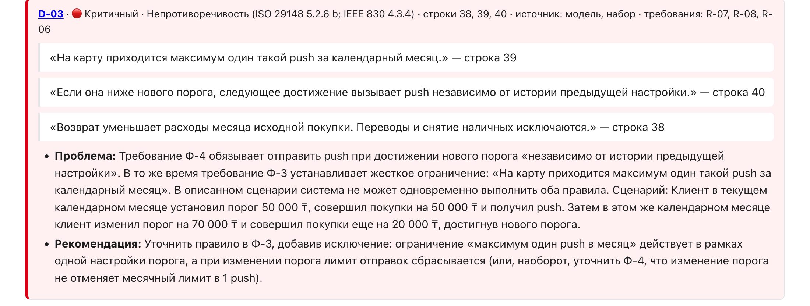
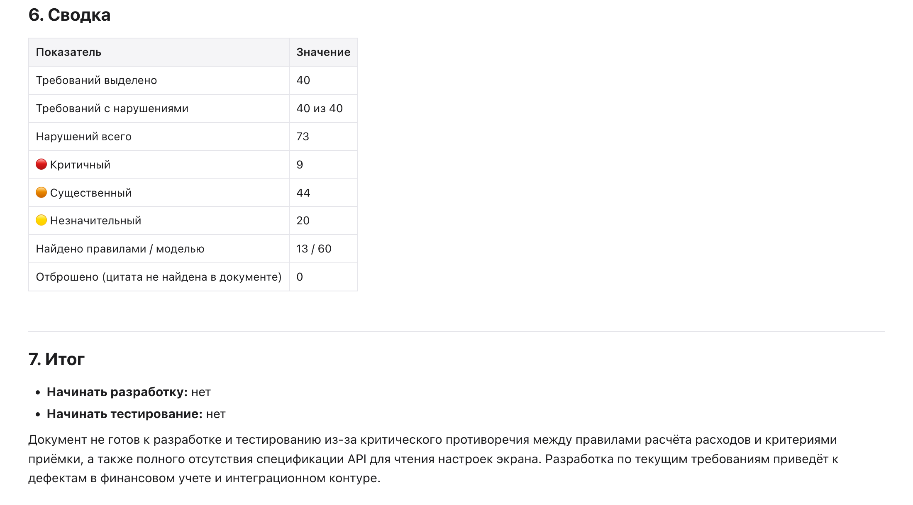
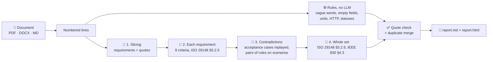

<div align="center">



# BCC Requirements Validator

**An AI agent that reviews a requirements document before development starts and writes a report in Russian.**

<p align="center">
  
  <a href="https://github.com/astmirzhan/BCC-Requirements-Validator/actions/workflows/tests.yml"></a>
</p>

<p align="center">
  
  
  
  
  
</p>

</div>

---

## 🎬 Demo video

https://github.com/user-attachments/assets/47194fdd-74ca-48ff-952d-914ca61d9654

The agent is run with one command on the organizers' document, analyses it and writes the report, in 3 minutes. [Watch in full quality on YouTube](https://youtu.be/E2UXIafsCMA) · [direct MP4](https://raw.githubusercontent.com/astmirzhan/BCC-Requirements-Validator/main/docs/readme/demo.mp4)

## 📌 What it does

You give the agent a requirements document (PDF, DOCX, Markdown or TXT). It:

1. **splits it into requirements**, each with an exact quote and line number;
2. **checks every requirement** against the nine characteristics of ISO/IEC/IEEE 29148:2018 §5.2.5;
3. **checks the whole set** against ISO 29148 §5.2.6 and IEEE 830-1998 §4.3: completeness, consistency, contradictions between sections;
4. **writes a report in Russian** (`.md` + `.html`). Every defect points to a concrete place in the document, and the report ends with a verdict on whether development and testing can start.

## 🔍 Result on the sample document

The agent was run on the organizers' document [`docs/requirements.md`](docs/requirements.md). Full report: [`reports/report.md`](reports/report.md) ([HTML version](reports/report.html)).

**40 requirements · 73 defects · 9 critical · verdict: do not start development.**



| Critical defect found | Where |
| :--- | :--- |
| Ф-3 «max one push a month» contradicts Ф-4 «push regardless of history», with a breaking scenario | lines 39, 40 |
| Ф-2 (month by purchase date) contradicts the acceptance case for 31 January | lines 38, 64 |
| Saving a setting is declared as `GET` | lines 103, 104 |
| Description says both «save» and «read», but there is no read method | lines 29, 52, 103 |
| `200 OK` returned with `result: ERROR`, conflicting with `400` | lines 121, 151, 162–171 |
| `403` declared, but the text says to return `404` for a foreign card | lines 118, 175, 189 |
| `amount` / `enabled` are integers in the request and strings in the response | lines 143–157 |

Rules without a model also catch tiyn vs tenge units, an empty Prod URL, a Content-Type with no body, no document version, empty approvers, an unfilled checklist and a missing rollback plan.



## 🚀 Quick start

```bash
git clone https://github.com/astmirzhan/BCC-Requirements-Validator.git
cd BCC-Requirements-Validator
python3 -m venv .venv && source .venv/bin/activate
pip install -r requirements.txt
cp .env.example .env            # put your key into .env
python -m validator docs/requirements.md report.md
```

**The command:** `python -m validator <input file> <report file>`

- `docs/requirements.md` is the organizers' document (also in `examples/` together with a PDF copy);
- the report is written to the path given as the second argument (`report.md` above), with an `.html` file next to it;
- inputs: **PDF** (with a text layer), **DOCX**, **Markdown**, **TXT**;
- options: `--model <name>` overrides the model for one run, `--no-cache` forces fresh model calls.

Requires Python 3.11+ (tested on 3.11 and 3.12).

## 🔑 Getting a key

The default model is **Google Gemini**, free tier, no card needed:

1. Open [aistudio.google.com](https://aistudio.google.com/) and sign in with a Google account.
2. **Get API key** → **Create API key**.
3. Put it into `.env`: `GEMINI_API_KEY=...`

`.env` is in `.gitignore`, so the key is never committed. `.env.example` lists every setting without a key.

| Setting | Default |
| :--- | :--- |
| `LLM_PROVIDER` | `gemini` (or `openai`, `ollama`) |
| `GEMINI_MODEL` | `gemini-3.8-flash` |
| `GEMINI_FALLBACK_MODELS` | `gemini-3.7-flash,gemini-3.5-flash,gemini-3.5-flash-lite`, used when the main model is overloaded or out of quota |
| `LLM_TEMPERATURE` | `0` |

**Inside a bank network.** Internal requirements often may not leave the company. The same agent runs on a local model through [Ollama](https://ollama.com/), and the document stays on the computer:

```bash
ollama pull qwen2.5:14b
# in .env
LLM_PROVIDER=ollama
OLLAMA_MODEL=qwen2.5:14b
```

Any OpenAI-compatible API works the same way (`LLM_PROVIDER=openai`, see `.env.example`).

## 🧠 How it works



- **4 model calls per run.** Answers are cached in `.cache/llm/`, so a repeat run on the same document is instant and free.
- **No claims without a place in the text.** Every quote the model returns is looked up in the document. Findings whose quote is not found are removed from the summary and listed in an appendix.
- **Deterministic rules** (`validator/rules.py`) catch what a model can miss and never hallucinate. Their findings are passed to the model as "already found", so it looks for other defects.
- **Works on a free tier.** If a model is overloaded (503) or out of quota (429), the agent switches to the next fallback model. The passport records which model did each step.
- **Strict verdict.** Any critical defect means "do not start development", whatever the model says.

## 📄 Report contents

1. **Run passport:** document, SHA-256, date, model per step, agent version and commit.
2. **Slicing:** every requirement with its document id, section, type and quote.
3. **Each requirement:** a criteria matrix and every defect with quote, problem and recommendation.
4. **Whole set:** completeness, consistency, feasibility, comprehensibility, validatability, ranking, modifiability, traceability.
5. **Rule checks** done without a model.
6. **Summary:** counts by severity and the list of critical defects.
7. **Verdict:** can development and testing start, and what to fix first.

Severity: 🔴 critical (cannot be built or tested unambiguously) · 🟠 major · 🟡 minor.

## 📁 Project layout

```
validator/
  __main__.py   CLI entry point
  loader.py     PDF / DOCX / Markdown reading into numbered lines
  rules.py      deterministic checks
  prompts.py    prompts for the four model steps
  criteria.py   ISO 29148 / IEEE 830 criteria
  llm.py        Gemini / OpenAI-compatible / Ollama client: JSON, fallbacks, cache, log
  quotes.py     quote verification
  pipeline.py   review pipeline and duplicate merging
  report.py     Markdown report
  html.py       HTML version of the report
tests/          pytest suite, no model calls
docs/           organizers' requirements.md, README images
examples/       sample document (.md and .pdf)
reports/        report produced by the agent
```

## 🧪 Tests

```bash
pip install -r requirements-dev.txt
python -m pytest
```

25 tests run in under a second with no key and no network: rules on the sample document, quote verification, duplicate merging, PDF reading, and the whole pipeline with a fake model (the critical-defect verdict, dropped findings with invented quotes). GitHub Actions runs them on Python 3.11 and 3.12 on every push.

Every model call is logged to `logs/llm_calls.jsonl` (prompt, answer, model, time) for audit. The folder is not committed.
